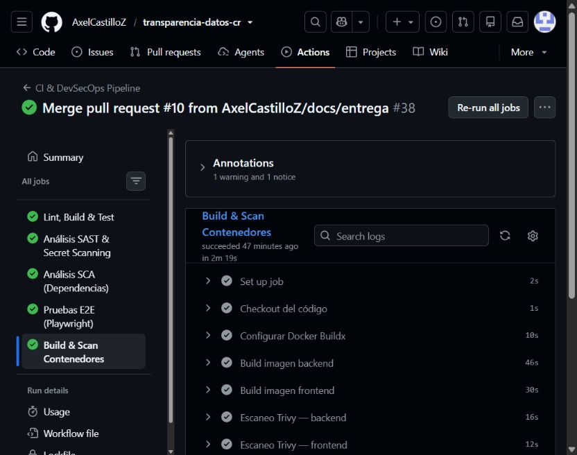
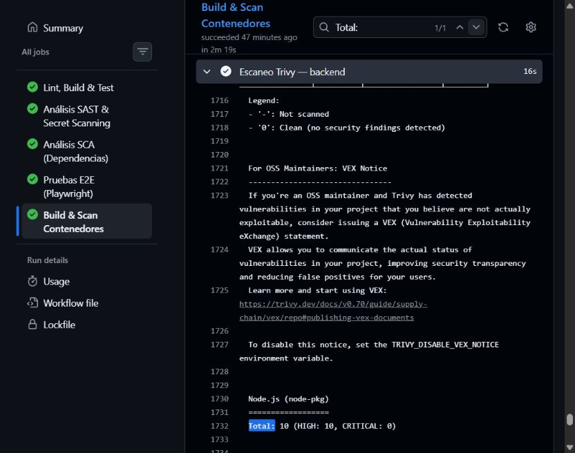
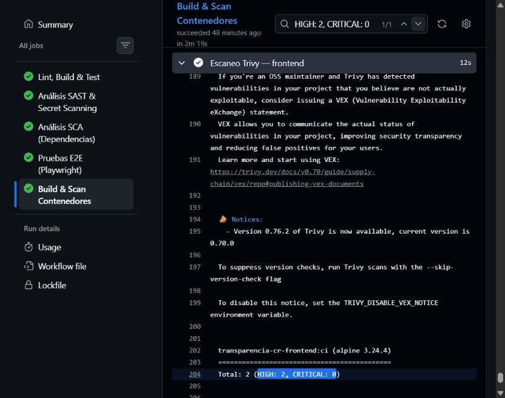

# Evidencias del escaneo de contenedores

| Evidencia | GitHub Actions |
| --- | --- |
| Ejecución #38 | [Resumen](https://github.com/AxelCastilloZ/transparencia-datos-cr/actions/runs/42916226001) |
| Job Build & Scan Contenedores | [Job completo](https://github.com/AxelCastilloZ/transparencia-datos-cr/actions/runs/42916226001/job/130179585817) |
| Build backend | [Paso 4](https://github.com/AxelCastilloZ/transparencia-datos-cr/actions/runs/42916226001/job/130179585817#step:4:1) |
| Build frontend | [Paso 5](https://github.com/AxelCastilloZ/transparencia-datos-cr/actions/runs/42916226001/job/130179585817#step:5:1) |
| Trivy backend | [Paso 6](https://github.com/AxelCastilloZ/transparencia-datos-cr/actions/runs/42916226001/job/130179585817#step:6:1) |
| Trivy frontend | [Paso 7](https://github.com/AxelCastilloZ/transparencia-datos-cr/actions/runs/42916226001/job/130179585817#step:7:1) |
| Recuento HIGH y CRITICAL | [Resultados documentados](../../CONTAINER_SCANNING.md#resultados-de-github-actions) |

## Capturas de la ejecución #38

